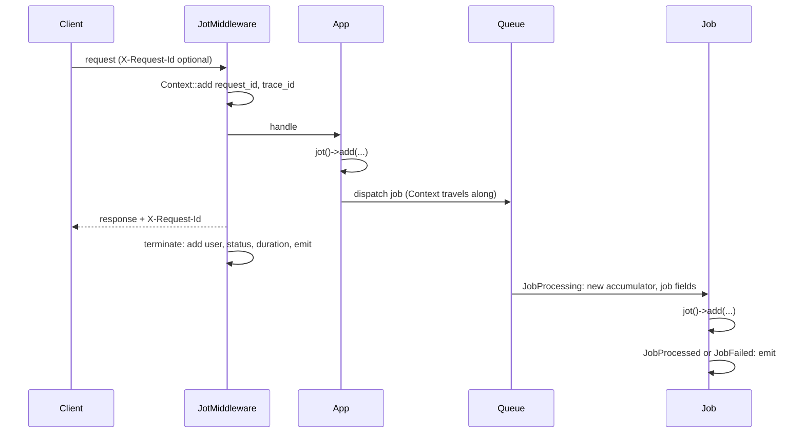

# Laravel Jot

Laravel Jot writes one structured log event ("wide event") per HTTP request, queued job, Artisan command or scheduled task, with a typed schema that keeps the fields queryable.

> Status: specification. Nothing is implemented yet.

## Why

Classic logs scatter many short lines across a request. Finding everything about one failed checkout means searching for strings and stitching lines together by hand.

A wide event (also called a canonical log line) is a single log entry that holds all the context for one unit of work: request ID, HTTP status, duration, user, business data, errors. The code fills the event as it runs and the package writes it once, at the end. The idea comes from [loggingsucks.com](https://loggingsucks.com/), an article on why wide events beat line-by-line logs.

Laravel Jot applies the idea with one verb: code anywhere in the request jots fields down with `jot()`, and the package writes them as one wide event.

## Requirements

- PHP 8.3
- Laravel 11 or later, which provides the `Context` facade (the Laravel feature that shares data across a request and its queued jobs)

## Features

- Zero setup: install the package and every request, job, command and scheduled task writes a wide event.
- `jot()` global helper, with a `Jot` facade as a fallback.
- Request ID and trace ID on every request, propagated to queued jobs through Laravel Context.
- Automatic fields: user, hashed session, login outcome, HTTP details, errors, duration, database usage.
- Typed section classes that define the log schema.
- Backed enums for fields with a fixed set of values.
- Tail sampling: keep every error and slow request, sample the rest.
- Strict mode that rejects fields outside the schema.

## Installation

```sh
composer require phlisg/laravel-jot
```

Nothing else is required. The package registers itself:

- `jot()` helper: declared in the package's own `composer.json` (`autoload.files`). Composer loads it for every app that installs the package.
- Service provider: found by Laravel package auto-discovery.
- Middleware: the service provider adds it to the global HTTP middleware stack.
- Queue and login listeners: registered by the service provider.
- Configuration: package defaults apply until the app publishes `config/jot.php`.

To change a default, publish the config file. It lists every feature with its default value:

```sh
php artisan jot:install
```

`php artisan vendor:publish --tag=jot-config` does the same.

## Concepts

- Wide event: the single entry written at the end of a request, job, command or scheduled task.
- Section: a class that groups related fields under one key prefix, for example `payment`. Its properties are the schema for that group.
- Accumulator: the object that holds the fields and sections for the current request or job. The container binds it as scoped, so it resets at each new request (including under Laravel Octane) and each new job.
- Emit: flatten every field and section into one array and write it to the log channel.

## Usage

Application code adds fields with the `jot()` helper. The method names follow Laravel Context, so they read the same:

```php
jot()->add('payment.provider', 'stripe');
jot()->add([
    'booking.event_id' => $event->id,
    'booking.event_slug' => $event->slug,
]);
jot()->addIfMissing('payment.currency', 'eur');
jot()->increment('payment.attempts');
jot()->push('payment.steps', 'intent_created');   // list field

jot(PaymentLog::class)->status = PaymentStatus::Declined;   // typed section, see "Sections" below
```

### Facade

The `Jot` facade exposes the same methods. Use it when the app already has its own `jot()` function, or in service providers and tests:

```php
use Phlisg\Jot\Facades\Jot;

Jot::add('payment.provider', 'stripe');
```

Without an import, the root alias works too: `\Jot::add(...)`. The pair mirrors Laravel's own `logger()` helper and `Log` facade.

> The package declares `jot()` inside `if (! function_exists('jot'))`. If another package or the app defines `jot()` first, that definition wins and no error occurs. Use the facade in that case.

## Sections

A section class extends `Phlisg\Jot\Section`, returns its prefix from `prefix()`, and declares typed, public properties.

```php
use Phlisg\Jot\Section;

final class PaymentLog extends Section
{
    public static function prefix(): string
    {
        return 'payment';
    }

    public ?PaymentProvider $provider = null;
    public ?string $intentId = null;
    public ?PaymentStatus $status = null;
    public int $attempts = 0;
    public ?int $latencyMs = null;
}

enum PaymentStatus: string
{
    case Approved = 'approved';
    case Declined = 'declined';
    case Error = 'error';
}
```

`jot(PaymentLog::class)` returns the same instance for the whole request, so any class can fill it:

```php
$payment = jot(PaymentLog::class);
$payment->provider = PaymentProvider::Stripe;
$payment->attempts++;

// Later, in another class, during the same request
jot(PaymentLog::class)->status = PaymentStatus::Declined;
```

The emitted event contains:

```json
{
  "request_id": "0b6f1c1e-5d0a-4a57-9a43-3f6f0f5f2a10",
  "trace_id": "0b6f1c1e-5d0a-4a57-9a43-3f6f0f5f2a10",
  "http.request.method": "POST",
  "http.route": "/checkout",
  "http.response.status_code": 402,
  "duration_ms": 412,
  "payment.provider": "stripe",
  "payment.status": "declined",
  "payment.attempts": 1
}
```

Flattening rules:

- Keys: the prefix, a dot, then the property name in snake case. `latencyMs` becomes `payment.latency_ms`.
- Backed enums: written as their backing value.
- `null` properties: skipped.
- Nested `Section` properties: flattened into deeper keys, for example `cart.coupon.code`.

### Where sections live

Sections are the recommended way to add fields. Keep them in `app/Jot`, one class per domain, for example `App\Jot\StripePayment`.

A section with a constructor is added in one call:

```php
use App\Jot\StripePayment;

jot()->add(new StripePayment(
    intentId: $intent->id,
    amountCents: $intent->amount,
    latencyMs: $latencyMs,
));
```

- Adding a second instance of the same class replaces the first.
- `jot(StripePayment::class)` returns the added instance. For a class with required constructor arguments, it returns `null` when no instance was added yet, so add such sections with `jot()->add(new ...)`.

### Base class

`Section` is abstract. Every section class shares one contract:

- `prefix()` is abstract, so a class without a prefix fails when PHP loads it.
- `Section` flattens the properties, so every section writes its fields with the same rules.
- `jot()->add()` and `jot(...)` accept `Section` subclasses only. Static analysis (PHPStan) reports any other object, and at runtime the package logs a warning and ignores it.

A Pest architecture test keeps `app/Jot` consistent:

```php
arch('jot sections')
    ->expect('App\Jot')
    ->toExtend(Phlisg\Jot\Section::class);
```

Section classes can extend each other, for example an abstract `Payment` section with shared fields, extended by `StripePayment` and `PaypalPayment`. Each concrete class returns its own prefix. A subclass that keeps its parent's prefix collides with it, see "Key collisions" below.

### Key collisions

String keys and sections can target the same key. The last write wins, and the package never throws during a request: logging must not break the app, even when `APP_ENV` is set wrong.

- The same string key added twice: a normal update. `payment.status` often changes during a request.
- The same section class added twice: a normal update, the new instance replaces the old one.
- A collision: a string key already written by a section (`payment.provider` next to `StripePayment`), two section classes with the same prefix, or a value and child keys under one name (`payment` next to `payment.provider`).

On a collision, the package keeps the last write and logs a warning on the app's default log channel. The warning names the key and what added it first:

```
[jot] Key "payment.provider" was already added by App\Jot\StripePayment, then overwritten by a string key.
```

The event also lists the colliding keys in `jot.collisions`, so one log query finds every request with a collision.

## Loose fields

A one-off field with no section uses `add` with a string or a backed enum key:

```php
jot()->add('feature.new_checkout', true);
jot()->add(Field::ExperimentVariant, 'b');
```

Strict mode is off by default, so string keys work everywhere. With strict mode on, the package still writes string keys, and logs a warning for each one on the app's default log channel. Enum keys and sections never trigger the warning.

## Field conventions

Log backends such as Elasticsearch fix a field's type the first time they see it. A later value of another type causes a mapping conflict, and queries on that field fail. These rules keep every field queryable:

- One type per key, forever. Typed section properties enforce this in PHP.
- Namespaced keys: `payment.provider`, never `provider`.
- Singular prefixes: `payment`, `booking`.
- Units in the name: `latency_ms`, `total_cents`.
- Backed enums for any field used to filter or group, such as status, provider, error type, or plan tier.
- IDs go in values, never in keys: `user.id = 42`, never `user_42.plan`.
- Domain words for prefixes. A booking app uses `booking.event_id`: a bare `event.*` prefix reads like the wide event itself or a Laravel event.

## Automatic fields

The package adds these fields with no code in the app. Each group has a switch under `fields` in `config/jot.php`, see "Configuration" below.

Field names follow the OpenTelemetry semantic conventions where one exists, see "Output shapes" below. Fields with no OpenTelemetry equivalent, such as `session.hash` or `laravel.version`, keep a Jot name.

Always on:

- `request_id`: the `X-Request-Id` header when trusted, otherwise a new UUID (universally unique identifier).
- `trace_id`: an incoming trace ID when trusted, otherwise the `request_id`. Queued jobs keep it, so one trace links a request to every job it dispatched.
- `timestamp`: start time, in ISO 8601 format.
- `entrypoint`: where the unit of work entered the app: `http`, `queue`, `console` or `schedule`.
- `origin`: the `entrypoint` of the first event in the trace. A job dispatched by a scheduled task has `entrypoint=queue` and `origin=schedule`.

By group:

| Group | Fields | Default |
|---|---|---|
| `http` | `http.request.method`, `http.route` (the route pattern, such as `/events/{event}`), `url.path`, `http.response.status_code`, `http.request.header.content-type`, `http.request.body.size`, `http.response.body.size`, `duration_ms` | on |
| `client` | `user_agent.original` (first 256 characters), `client.address` | user agent on, IP anonymized |
| `query` | `url.query`: the query string with only the keys in `query.allow` | no key allowed |
| `session` | `session.hash`: a keyed hash of the session ID, to link requests from the same browser session | on |
| `user` | `user.id`, read at the end of the request so that a login during the request is included | on |
| `auth` | `auth.result`: `success` or `failed`, only on requests that attempt a login. The package listens to Laravel's `Login` and `Failed` auth events | on |
| `locale` | `app.locale` | on |
| `app` | `deployment.environment.name`, `service.version`, `cloud.region`, `host.name`, `process.runtime.version`, `laravel.version` | on |
| `errors` | `error.*`, see "Errors" below | on |
| `performance` | `memory_peak_mb`, `db.query_count`, `db.time_ms`, `cache.hits`, `cache.misses`, `http_client.count`, `http_client.time_ms`, `queue.dispatched` | on |
| `pennant` | `feature.<name>` for each feature flag checked during the request | on when Laravel Pennant (Laravel's feature flag package) is installed |

> Open question: which Pennant event reports the features checked during a request. Check before implementing the `pennant` group.

Performance fields come from Laravel's own events: database queries, cache hits and misses, and requests sent by the HTTP client.

> Security: the package never logs the raw session ID. Anyone who reads the logs could use it to take over a live session. `session.hash` is an HMAC (keyed hash) of the ID with the app key, cut to 16 characters.

> Security: `url.path` holds no query string. Password reset tokens and signed URL signatures travel in the query string. The `query` group logs only the keys listed in `query.allow`.

> Privacy: an IP address is personal data under the GDPR (General Data Protection Regulation). The default `anonymized` mode zeroes the last IPv4 byte (`192.168.1.42` becomes `192.168.1.0`) or the last 80 bits of an IPv6 address. Behind a load balancer, configure Laravel's trusted proxies, otherwise every request logs the load balancer's IP.

> Privacy: a failed login logs `auth.result` only. The email or username that was tried stays out of the event.

### Login example

An anonymous user posts wrong credentials to `/login`. The event holds `auth.result=failed` and no `user.id`.

The user tries again with the right password. The event holds `auth.result=success` and the new `user.id`. The login controller adds nothing: the package reads the user at the end of the request.

### App fields

Some user fields depend on the app's data model: subscription tier, team, role, organization, account age, A/B test cohort. The package cannot guess them, so the app declares them once, in a service provider:

```php
use Phlisg\Jot\Facades\Jot;

Jot::user(fn (User $user) => [
    'user.plan' => $user->plan,
    'user.team_id' => $user->current_team_id,
    'user.role' => $user->role,
    'user.account_age_days' => $user->created_at->diffInDays(),
]);
```

The callback runs at the end of each request that has an authenticated user.

## Request lifecycle



HTTP:

1. `JotMiddleware` sets `request_id` and `trace_id`, and adds both to Context.
2. The application adds fields during the request.
3. The middleware adds `X-Request-Id` to the response.
4. In `terminate()`, the middleware adds the end-of-request fields listed in "Automatic fields", then emits.

Queue:

1. On dispatch, Laravel copies Context into the job payload (key `illuminate:log:context`), so the job keeps the `request_id` and `trace_id` of the request that started the chain.
2. On `JobProcessing`, the package starts a fresh accumulator and adds `job.id`, `job.name`, `job.queue` and `job.attempt`.
3. The package reads the dispatcher from the job payload and adds `parent_id`: the `request_id` of the dispatching request, or the `job.id` of the dispatching job. It then puts the new `job.id` in Context, so jobs dispatched from this job point back to it.
4. On `JobProcessed` or `JobFailed`, the package adds `duration_ms` and `job.status`, then emits.

The `parent_id` links form a tree, and every event in it shares one `trace_id`:

```
request  request_id=req_1
└─ job A  job.id=job_7  parent_id=req_1
   └─ job B  job.id=job_9  parent_id=job_7
```

No job class needs changes: the package listens to Laravel's queue events once for every job.

> The `sync` queue driver, `dispatchSync()` and `dispatchAfterResponse()` run the job inside the current process, and Laravel still fires `JobProcessing` and `JobProcessed` for it. The package keeps a stack: on `JobProcessing` it saves the current accumulator and Context IDs, and on `JobProcessed` or `JobFailed` it emits the job event and restores them. Without the stack, a sync job would erase the fields of the request that runs it.

Console:

1. On Laravel's `CommandStarting` event, the package starts an accumulator with `entrypoint=console`, a new `trace_id`, `console.command` (the command name, such as `invoices:send`), `console.arguments` and `console.options`.
2. On `CommandFinished`, the package adds `console.exit_code` and `duration_ms`, then emits.

Scheduler:

1. On `ScheduledTaskStarting`, the package starts an accumulator with `entrypoint=schedule`, `schedule.task` (the task description or command) and `schedule.expression` (the cron expression, such as `0 * * * *`).
2. On `ScheduledTaskFinished` or `ScheduledTaskFailed`, the package adds `schedule.exit_code` and `duration_ms`, then emits.

For `php artisan users:create jane@example.com --admin --password=secret`, the event holds:

```json
{
  "console.command": "users:create",
  "console.arguments": ["email"],
  "console.options": ["--admin", "--password"]
}
```

> Security: the package logs argument and option names, never their values. Values can carry secrets, such as the password above. `console.options` lists only the options passed on the command line: the package drops options that still hold their default value.

> Long-running commands such as `queue:work`, `horizon` or `octane:start` would write one event when they stop, hours later. `console.ignore` in `config/jot.php` skips them. The jobs and requests they run still write their own events.

> Open question: the scheduler runs a scheduled Artisan command in a child process, which writes its own `console` event. Check whether the scheduler can pass the `trace_id` to that process before implementing, so that both events link.

> Only IDs live in Context. Fields and sections live in the accumulator. Context is appended to every log line and copied into every dispatched job, so storing fields there would copy the whole request event into each job event.

## Example: paid event booking

A user books a paid event: they open the event page, fill in their details, and pay with Stripe. Each step is a separate HTTP request, so each step writes its own wide event.

| Request | Fields added by the app |
|---|---|
| `GET /events/{event}` | `booking.event_id`, `booking.event_slug` |
| `POST /events/{event}/details` | `booking.event_id` |
| `POST /events/{event}/pay` | `booking.event_id`, `payment.provider=stripe`, `payment.intent_id`, `payment.status` |
| `POST /stripe/webhook` | `payment.intent_id`, `payment.status` |

The payment step in code:

```php
jot()->add('booking.event_id', $event->id);

$payment = jot(PaymentLog::class);
$payment->provider = PaymentProvider::Stripe;
$payment->intentId = $intent->id;
$payment->status = PaymentStatus::Approved;
```

Fields never carry over from one request to the next. Each request adds what it knows, usually from the route. To follow one user through the funnel, query the log backend on `booking.event_id` plus `session.hash` or `user.id`.

> The Stripe webhook comes from Stripe's servers, so it has no session and no user. Store the `trace_id` in the payment intent `metadata`, and add it back in the webhook handler to link both events.

## Errors

The service provider registers an exception reporting callback. When an exception is reported during a request or job, the package fills the built-in `ErrorLog` section:

- `error.type`: exception class
- `exception.message`: exception message
- `error.code`: exception code
- `error.retriable`: `true` when the exception implements `Phlisg\Jot\Contracts\Retriable`

## Sampling

The package decides at emit time whether to write the event (tail sampling). It keeps:

- Every event with `http.response.status_code` of 500 or more, a failed job, or an `error.type`.
- Every event slower than `slow_ms`.
- Every event where a custom rule returns `true`, for example enterprise customers.
- A random `rate` share of all other events.

Register custom rules in a service provider:

```php
Jot::keepWhen(fn (array $event) => ($event['user.plan'] ?? null) === 'enterprise');
```

## Configuration

Every setting lives in `config/jot.php`. The file lists each feature with its default, so the app turns features on or off in one place. Publish it with `php artisan jot:install`.

```php
use Phlisg\Jot\Enums\OutputShape;

return [

    'enabled' => env('JOT_ENABLED', true),

    // One entry per destination. Each output writes the same event in its own shape.
    'outputs' => [
        // channel null: a daily file in storage/logs with one JSON object per line.
        ['channel' => env('JOT_CHANNEL'), 'shape' => OutputShape::Flat],
    ],

    'request_id' => [
        'header' => 'X-Request-Id',
        // Enable only behind a proxy that sets or strips this header.
        'trust_incoming' => env('JOT_TRUST_INCOMING_HEADER', false),
    ],

    'app' => [
        'version' => env('APP_VERSION'),
        'region' => env('JOT_REGION'),
    ],

    'fields' => [
        'http' => true,

        'client' => [
            'user_agent' => true,
            // false, 'anonymized' or 'full'. An IP address is personal data under the GDPR.
            'ip' => 'anonymized',
        ],

        // Query keys to log, wildcards allowed, e.g. ['utm_*']. Never list token keys.
        'query' => [
            'allow' => [],
        ],

        'session' => true,
        'user' => true,
        'auth' => true,
        'locale' => true,
        'app' => true,
        'errors' => true,

        'performance' => [
            'memory' => true,
            'db' => true,
            'cache' => true,
            'http_client' => true,
            'queue' => true,
        ],

        // Ignored when laravel/pennant is not installed.
        'pennant' => true,
    ],

    'queue' => [
        'enabled' => true,
    ],

    'console' => [
        'enabled' => true,
        'schedule' => true,
        // Long-running commands, wildcards allowed.
        'ignore' => [
            'queue:work', 'queue:listen', 'horizon*', 'octane:*', 'reverb:start',
            'schedule:run', 'schedule:work', 'pail', 'tinker',
        ],
    ],

    // Logs a warning for each string key written outside a section.
    'strict' => env('JOT_STRICT', false),

    'sampling' => [
        // Share of normal events to keep, from 0.0 to 1.0. Errors and slow events are always kept.
        'rate' => env('JOT_SAMPLE_RATE', 1.0),
        'slow_ms' => 1000,
    ],

];
```

Settings that need a decision per app:

- `outputs`: each entry pairs a log channel from `config/logging.php` with a shape, see "Output shapes" below. The channel's formatter encodes the event (JSON, logfmt, and so on). Use a JSON formatter so the log backend can index each field.
- `request_id.trust_incoming`: off by default, so that clients cannot choose their own request ID or trace ID. Turn it on behind a proxy or load balancer that sets the header.
- `app.version`: value of the `service.version` field, a git commit hash or release tag, to compare errors between deploys.
- `fields.client.ip`: `anonymized` by default. `full` needs a legal basis under the GDPR.
- `fields.query.allow`: empty by default. Add marketing keys such as `utm_*`, never tokens or signatures.
- `sampling.rate`: lower it when log volume costs too much. Errors and slow events stay at 100%.

## Output shapes

Each entry in `outputs` pairs a log channel with a shape. The shape sets the structure of the event array. The channel's formatter then encodes it as JSON, logfmt or another format.

- `OutputShape::Flat`: one level with dotted keys, `{"http.request.method": "POST"}`. The default. Suits Datadog, Loki and most search backends.
- `OutputShape::Nested`: Laravel's `Arr::undot()` turns dotted keys into nested arrays, `{"http": {"request": {"method": "POST"}}}`. XML formatters need this shape.
- `OutputShape::Otel`: the OpenTelemetry log data model. Service fields such as `service.version` go to `Resource`, the other fields go to `Attributes`, and `trace_id` goes to `TraceId`.

The package stores fields as flat dotted keys during the request and builds each shape once, when it writes the event.

### OpenTelemetry

OpenTelemetry (OTel) is an open standard for traces, metrics and logs, supported by most observability tools.

Field names come from `open-telemetry/sem-conv`, the official PHP package of OTel attribute names. It is a dependency of Jot and requires nothing but PHP. The package uses its constants, so every name matches the standard, for example `HttpAttributes::HTTP_REQUEST_METHOD` for `http.request.method`.

> OTel marks some names as incubating, which means a later OTel release can still rename them. Jot uses these incubating names: `host.name`, `user.id`, `http.request.body.size`, `http.response.body.size` and `process.runtime.version`.

Export needs no Jot configuration and no code in the app:

1. Install the OpenTelemetry PHP SDK and OTLP exporter in the app: `composer require open-telemetry/sdk open-telemetry/exporter-otlp`.
2. Set the standard OTel environment variables:
   ```sh
   OTEL_PHP_AUTOLOAD_ENABLED=true
   OTEL_SERVICE_NAME=my-app
   OTEL_LOGS_EXPORTER=otlp
   OTEL_EXPORTER_OTLP_ENDPOINT=http://collector:4318
   ```
3. Jot adds an `OutputShape::Otel` output that sends each event through the SDK logger, next to the outputs in `config/jot.php`.

`OTEL_PHP_AUTOLOAD_ENABLED=true` makes the SDK register a global logger provider when Composer loads. Jot reads it from `OpenTelemetry\API\Globals::loggerProvider()`. Without the SDK, or with autoload off, that call returns a `NoopLoggerProvider`, and Jot adds no OTel output.

Apps that set up the SDK in code instead of environment variables register the provider themselves, for example in `AppServiceProvider`:

```php
use OpenTelemetry\SDK\Sdk;

Sdk::builder()
    ->setLoggerProvider($loggerProvider)
    ->buildAndRegisterGlobal();
```

Jot detects a provider registered this way too.

When an OTel span is active, Jot uses its trace ID as `trace_id`, so Jot events line up with the app's OTel traces.

> An `outputs` entry with `OutputShape::Otel` replaces the automatic output. Without the SDK, such an entry writes OTel-shaped events to a log channel, and an OpenTelemetry Collector can read that file.

## Out of scope

- W3C `traceparent` header propagation between services. Add when several services need one shared trace.
- Generated index templates or schema docs from section classes.

## Versioning

The package follows semantic versioning and starts at `0.x`. Until `1.0.0`, a minor release (`0.1` to `0.2`) can contain breaking changes. Patch releases (`0.1.0` to `0.1.1`) never do.

- First release: tag `v0.1.0`.
- Composer's caret constraint on a `0.x` version stays within one minor release: `composer require phlisg/laravel-jot:^0.1` installs `0.1.*` only.
- `CHANGELOG.md` lists the breaking changes of each minor release.

`1.0.0` comes once the public API (`jot()`, the `Jot` facade, `Section`, `config/jot.php`) is stable.

## Development

PHP and Composer run in Docker, so the host needs no PHP.

### Docker

Requirements: Docker with the Compose plugin (`docker compose version` prints a version).

How it works:

- `Dockerfile`: FrankenPHP image for the chosen PHP version, plus Composer and the `zip` extension.
- `compose.yaml`: one service, `php`, that mounts the package folder at `/app` and runs as your user, so created files stay yours.
- `docker compose run --rm php <command>`: starts a throwaway container, runs the command in `/app`, then removes the container.

The first run builds the image, which takes a minute. Later runs reuse it.

Common tasks:

1. Install dependencies: `docker compose run --rm php composer install`
2. Run the tests: `docker compose run --rm php composer test`
3. Run static analysis (PHPStan with Larastan): `docker compose run --rm php composer analyse`
4. Format the code: `docker compose run --rm php composer format`

Any other PHP or Composer command follows the same pattern:

```sh
docker compose run --rm php composer require --dev some/package
docker compose run --rm php vendor/bin/pest --filter=PaymentLog
docker compose run --rm php php -v
```

Open a shell in the container to run several commands in a row:

```sh
docker compose run --rm php sh
```

> Your user ID is not 1000? Export it first: `export UID GID=$(id -g)`. Otherwise files in `vendor/` belong to another user.

After a change to `Dockerfile`, rebuild the image: `docker compose build php`.

Optional shortcut, for the current shell session:

```sh
alias dphp='docker compose run --rm php'
dphp composer test
```

### PHP versions

`PHP_VERSION` picks the PHP version: `8.3` (default), `8.4` or `8.5`. Each version builds its own image, tagged `laravel-jot-php:<version>`.

```sh
PHP_VERSION=8.5 docker compose run --rm php composer update
PHP_VERSION=8.5 docker compose run --rm php composer test
```

> Run `composer update` after switching versions. `composer.lock` is git-ignored, and a lock resolved on one PHP version can fail on another.

The GitHub Actions workflow covers PHP 8.3 to 8.5 and Laravel 11 to 13.

## Testing

```php
use Phlisg\Jot\Facades\Jot;

Jot::fake();

$this->post('/checkout');

Jot::assertEmitted(fn (array $event) => $event['payment.status'] === 'declined');
```
