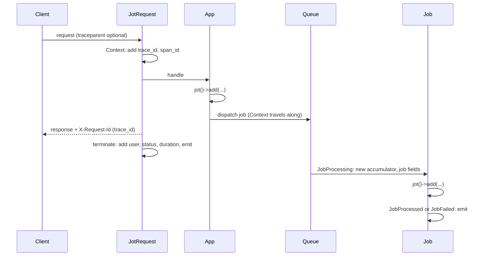

# Architecture

How Jot collects fields during a unit of work and writes them as one event. For usage, see the README.

## Classes

- `Jot`: the accumulator. Holds the fields and sections of the current request, job, command or scheduled task. Bound as scoped, so the container drops it at each new request (including under Laravel Octane) and each new job.
- `Writer`: singleton. Samples each event and writes it to the outputs. Holds what must outlive the accumulator: `keepWhen` and `dropWhen` rules, the `Jot::user()` callback and the fake used by `Jot::fake()`.
- `Lifecycle`: singleton. Listens to queue, console, scheduler, auth and performance events. Starts and emits the event of each job, command and scheduled task.
- `Middleware\JotRequest`: global HTTP middleware. Starts the request event in `handle()`, emits it in `terminate()`.
- `Sections\*`: built-in sections, one per group of automatic fields. The accumulator keeps them apart from app sections, keyed by class.

## Context

Laravel Context shares data across a request and the jobs it dispatches. Jot stores IDs there and nothing else:

- `trace_id`: shared by every event in the chain.
- `span_id`: the event running now, so a job or command it starts can point back to it.
- `origin`: the `entrypoint` of the first event in the chain.

Context is appended to every log line and copied into every dispatched job. Fields stored there would copy the whole request event into each job event.

## Request lifecycle



HTTP:

1. `handle()` builds the request sections and adds the IDs to Context.
2. The app adds fields during the request.
3. `handle()` adds the `X-Request-Id` header, holding the `trace_id`, to the response.
4. `terminate()` adds the end-of-request fields (route, status, user, session, locale), then emits.

The route is read in `terminate()`: global middleware runs before routing.

Queue:

1. On dispatch, Laravel copies Context into the job payload (key `illuminate:log:context`).
2. On `JobProcessing`, Laravel restores that Context first. Jot then starts a fresh accumulator with `job.id`, `job.name`, `job.queue` and `job.attempt`.
3. `trace_id` and `parent_span_id` come from Context. Jot then puts the job's new `span_id` in Context.
4. The first of these events emits, with its `job.status`:
   - `JobProcessed`: `processed`
   - `JobFailed`: `failed`
   - `JobReleasedAfterException`: `released`, the job will run again

The worker reports a job's exception after the job event is gone. Jot listens to `JobExceptionOccurred` to fill `error.*` while the job event is still open.

The `parent_span_id` links form a tree, and every event in it shares one `trace_id`:

```
request  span_id=a1  trace_id=t1
└─ job A  span_id=b2  parent_span_id=a1  trace_id=t1
   └─ job B  span_id=c3  parent_span_id=b2  trace_id=t1
```

The IDs follow W3C Trace Context, as in OpenTelemetry. `job.id` stays Laravel's job UUID, apart from `span_id`.

Console:

1. On `CommandStarting`, Jot starts an accumulator with `entrypoint=console`, a new `span_id` and `console.command`. `trace_id` and `parent_span_id` come from Context when set, so `Artisan::call()` in a request joins its trace.
2. On `CommandFinished`, Jot adds `console.exit_code`, `console.arguments` and `console.options`, then emits.

The names of arguments and options are read at the end, once the input is bound to the command definition. Only those that differ from their default are kept.

Commands in `console.ignore` write no event. Their jobs and requests still do.

Scheduler:

1. On `ScheduledTaskStarting`, Jot starts an accumulator with `entrypoint=schedule`, `schedule.task` and `schedule.expression`.
2. On `ScheduledTaskFinished` or `ScheduledTaskFailed`, Jot adds `schedule.exit_code`, then emits.

Livewire:

1. Each component action is a `POST` to the `livewire.update` route, so it gets an HTTP event like any request.
2. `Lifecycle` listens to Livewire's `hydrate`, `update`, `call` and `exception` hooks, and fills `Sections\LivewireSection` only on that route. The same hooks fire on the first page load, which stays a plain HTTP event.
3. A listener must return nothing. Livewire calls back any returned closure when the request ends.
4. Livewire answers a failed validation with a 200 and never reports it. The `exception` hook still sees it, which gives `livewire.validation_*`.

The hooks are public (`Livewire::listen()`) but undocumented. Livewire 3 and 4 call them with the same first arguments, and Livewire 4 adds `$metadata` to `call`, which marks a `wire:poll`.

## The stack

A sync job, `dispatchAfterResponse()` or `Artisan::call()` runs inside the current process. `Lifecycle` keeps a stack:

1. On start, it saves the current accumulator and Context, then binds a fresh accumulator.
2. On end, it emits the event, then restores both.

Without the stack, a sync job would erase the fields of the request that runs it.

Each stack entry is keyed by the job, command input or scheduled task object. An end event for any other object is ignored, which covers a job that fires `JobFailed` then `JobProcessed`. When the app terminates, the entries left over emit. A command that throws on Laravel 11 never fires `CommandFinished`.

## Building the event

The accumulator stores fields as flat dotted keys and flattens sections when it builds the event:

1. App fields, in order of first write.
2. App sections on top.
3. Built-in sections, written first in the event and winning any shared key.
4. A value with child keys under the same name (`payment` next to `payment.provider`) drops the value. The nested output shape cannot hold both.

Keys that share a first segment sit side by side, each group where its first key appeared.

Each collision logs a warning on the default log channel, see [Key collisions](../README.md#key-collisions).

## Writing

`Writer` decides at emit time whether to keep the event (tail sampling), then writes it once per entry in `outputs`. Each output shape is built from the flat event when it is written.

Each event gets a log level from its fields (`Writer::level()`), and an output with a `level` key skips events below it. When the Sentry SDK is installed with logs on, `Writer::outputs()` adds the SDK's `sentry_logs` channel, unless the app lists it already. `Jot::tagSentry()` tags the Sentry scope with `trace_id` and `span_id`, and adds a "Jot" context with the `jot:query` command and the optional `jot.sentry.link`. It runs at each start, and again when the stack restores the previous event, so an issue never carries the IDs of a sync job that already ended.

An output with channel `null` writes to a daily file, `storage/logs/jot.log`, kept 7 days, with Monolog's `JsonFormatter`. It uses a plain Monolog logger: Laravel's channels append Context to each line, which would repeat the IDs. Errors while writing are reported and swallowed: logging never breaks the app.

## Open questions

- Pennant: which event reports the feature flags checked during a request.
- Scheduler: whether the scheduler can pass the `trace_id` to the child process of a scheduled command, so that both events link.
- OpenTelemetry: the exact mapping from a Jot event to an OTel `LogRecord` through the SDK logger.

## Out of scope

- An outgoing `traceparent` header on HTTP client calls. Add when several services need one shared trace.
- Index templates or schema docs generated from section classes.
