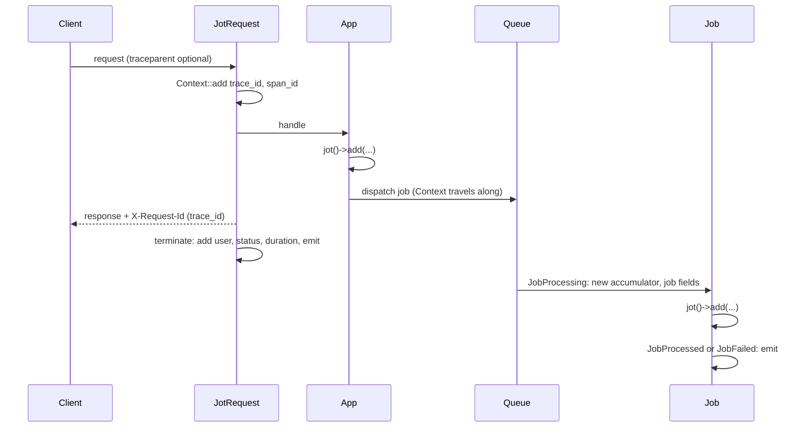

# Architecture

How Jot collects fields during a unit of work (a request, job, command or scheduled task) and writes them as one event. For usage, see the [README](../README.md).

```
 HTTP request           queued or sync job       artisan command        scheduled task
      │                        │                        │                      │
 JotRequest::handle()    Lifecycle: JobProcessing  Lifecycle: CommandStarting  Lifecycle: ScheduledTaskStarting
      └────────────────────────┴───────────┬────────────┴──────────────────────┘
                                           ▼
                           Jot::start(): fresh accumulator,
                           IDs in Context, Sentry scope tagged
                                           │
                     app: jot()->add(...)  │  Lifecycle and LivewireListener:
                     exception handler:    │  built-in sections (performance,
                     jot()->error($e)      │  auth, livewire.*)
                                           ▼
 JotRequest::terminate()  /  JobProcessed, JobFailed, JobReleasedAfterException
 CommandFinished  /  ScheduledTaskFinished, ScheduledTaskFailed  /  app terminating
                                           │
                                           ▼
                           Jot::emit(): build the flat event,
                           log key collisions
                                           │
                                           ▼
                           Writer::write() ─► Writer::keep(): sampling ─► dropped
                                           │ kept
                                           ▼
                           Jot::fake() on? ─► stored for assertEmitted()
                                           │ no
                                           ▼
                           one write per output in jot.outputs
                           (+ sentry_logs), each with its level and shape
```

To fix a bug, find the stage in this table, then read the section below.

| Symptom | Where to look |
|---|---|
| Wrong or missing IDs, broken parent links | [Context](#context), [The stack](#the-stack) |
| Field missing on a request, job, command or task event | [Units of work](#units-of-work) |
| A request's fields leak into a job event, or vanish | [The stack](#the-stack) |
| Wrong key order, lost value, collision warning | [Building the event](#building-the-event) |
| Event never written, or written to the wrong place | [Writing](#writing) |

## Contents

- [Classes](#classes)
- [Context](#context)
- [Units of work](#units-of-work)
  - [Request](#request)
  - [Queue](#queue)
  - [Console](#console)
  - [Scheduler](#scheduler)
  - [Livewire](#livewire)
- [The stack](#the-stack)
- [Building the event](#building-the-event)
- [Writing](#writing)
- [Open questions](#open-questions)
- [Out of scope](#out-of-scope)

## Classes

| Class | Lifetime | Role |
|---|---|---|
| `Jot` | scoped | The accumulator. Holds the fields and sections of the current unit of work. The container drops it at each new request (including under Laravel Octane) and each new job. |
| `Writer` | singleton | Samples each event (`Writer::keep()`) and writes it to the outputs. Holds what must outlive the accumulator: `keepWhen` and `dropWhen` rules, the `Jot::user()` callback and the fake used by `Jot::fake()`. |
| `Lifecycle` | singleton | Listens to queue, console, scheduler, auth and performance events. Starts and emits the event of each job, command and scheduled task, and keeps the stack. |
| `LivewireListener` | registered by `Lifecycle` | Listens to Livewire's hooks and fills `Sections\LivewireSection` on update requests. |
| `Middleware\JotRequest` | global HTTP middleware | Starts the request event in `handle()`, emits it in `terminate()`. |
| `Sections\*` | one per event | Built-in sections, one per group of automatic fields. The accumulator keeps them apart from app sections, keyed by class. |

`JotServiceProvider` binds these classes, pushes the middleware, registers `Lifecycle`, and adds a `reportable()` callback to the app's exception handler that calls `jot()->error($e)`. Every reported exception fills `error.*` on the current event.

## Context

Laravel Context shares data across a request and the jobs it dispatches. Jot stores IDs there and nothing else:

- `trace_id`: shared by every event in the chain.
- `span_id`: the event running now, so a job or command it starts can point back to it.
- `origin`: the `entrypoint` of the first event in the chain.

Context is appended to every log line and copied into every dispatched job. Fields stored there would copy the whole request event into each job event.

A new event reads `trace_id` and `span_id` from Context (`RequestSection::fromContext()`), takes them as its `trace_id` and `parent_span_id`, then writes its own `span_id` back. The `parent_span_id` links form a tree, and every event in it shares one `trace_id`:

```
request  span_id=a1  trace_id=t1
└─ job A  span_id=b2  parent_span_id=a1  trace_id=t1
   └─ job B  span_id=c3  parent_span_id=b2  trace_id=t1
```

`job.id` stays Laravel's job UUID (universally unique identifier), separate from `span_id`.

## Units of work

### Request



1. `handle()` calls `Jot::initialize()`, which builds the request sections and adds the IDs to Context. With `jot.trace.trust_incoming` on, a valid `traceparent` header supplies the `trace_id` and `parent_span_id`.
2. The app adds fields during the request.
3. `handle()` adds the `X-Request-Id` header, holding the `trace_id`, to the response.
4. `terminate()` calls `Jot::finalize()`, which adds the end-of-request fields (route, status, user, session, locale), then emits.

The route is read in `terminate()`: global middleware runs before routing.

The user comes from the `Authenticated` and `Login` events that `Lifecycle` heard on any guard, cleared by `Logout` or `CurrentDeviceLogout` on the same guard. In `terminate()`, a user already held by the default guard replaces it. Jot checks `hasUser()` first: calling `user()` would load the user, and could sign the visitor in from the remember-me cookie after the session is saved.

Error page: with `jot.error_page` on, the service provider appends `resources/views` to `view.paths`. Laravel's `RegisterErrorViewPaths` looks for an error view in `errors/` under each view path in order, then in its own views, so the app's `errors/500.blade.php` comes first and Jot's page replaces only Laravel's default.

### Queue

1. On dispatch, Laravel copies Context into the job payload (key `illuminate:log:context`).
2. On `JobProcessing`, Laravel restores that Context first. Jot then pushes a fresh accumulator with `job.id`, `job.name`, `job.queue` and `job.attempt`, and takes its IDs from Context.
3. The first of these events emits, with its `job.status`:
   - `JobProcessed`: `processed`
   - `JobFailed`: `failed`
   - `JobReleasedAfterException`: `released`, the job will run again

The worker fires `JobFailed` before `JobExceptionOccurred`, the sync queue after. Jot listens to both and fills `error.*` from whichever fires while the job's event is on top of the stack.

### Console

1. On `CommandStarting`, Jot pushes an accumulator with `entrypoint=console`, a new `span_id` and `console.command`. `trace_id` and `parent_span_id` come from Context when set, so `Artisan::call()` in a request joins its trace. Commands matching `jot.console.ignore` get no event.
2. On `CommandFinished`, Jot adds `console.exit_code`, `console.arguments` and `console.options`, then emits.

A failed outer command waits for the app to terminate instead: Laravel reports its exception after `CommandFinished`, so the error lands on the event first.

The names of arguments and options are read at the end, once the input is bound to the command definition.

### Scheduler

1. On `ScheduledTaskStarting`, Jot pushes an accumulator with `entrypoint=schedule`, `schedule.task` and `schedule.expression`. It starts a new `trace_id`, with no `parent_span_id`.
2. On `ScheduledTaskFinished` or `ScheduledTaskFailed`, Jot adds `schedule.exit_code`, then emits. `ScheduledTaskFailed` also fills `error.*`.

### Livewire

1. Each component action is a `POST` to the `livewire.update` route, so it gets an HTTP event like any request.
2. `LivewireListener` listens to Livewire's `hydrate`, `update`, `call` and `exception` hooks, and fills `Sections\LivewireSection` on that route only. The same hooks fire on the first page load, which stays a plain HTTP event.
3. A listener must return nothing. Livewire calls back any returned closure when the request ends.
4. The `exception` hook sees the validation exception that Livewire never reports, which gives `livewire.validation_*`.

The hooks are public (`Livewire::listen()`) but undocumented. Livewire 3 and 4 call them with the same first arguments, and Livewire 4 adds `$metadata` to `call`, which marks a `wire:poll`.

## The stack

A sync job, `dispatchAfterResponse()` or `Artisan::call()` runs inside the current process, while the current event is still open. `Lifecycle` keeps a stack so each one gets its own event:

```
request starts       stack: []                     current: request
sync job starts      stack: [job → request]        current: job
sync job ends        emit job, restore request     current: request
request terminates   emit request (JotRequest)
```

1. On start (`push()`), it saves the current accumulator and Context, then binds a fresh accumulator.
2. On end (`pop()`), it emits the event, restores both, and tags the Sentry scope again with the restored IDs.

Without the stack, a sync job would erase the fields of the request that runs it.

Each stack entry is keyed by the job, command input or scheduled task object. An end event for any other object is ignored, which covers a job that fires `JobFailed` then `JobProcessed`.

When the app terminates, leftover entries emit. This covers a failed outer command, and a command that throws on Laravel 11, which never fires `CommandFinished`.

## Building the event

`Jot::emit()` sets `duration_ms`, builds the event with `Jot::build()`, logs each collision, then hands the event to `Writer::write()`. An accumulator that never started emits nothing.

The accumulator stores fields as flat dotted keys and flattens sections when it builds the event:

1. App fields, in order of first write.
2. App sections on top.
3. Built-in sections, written first in the event and winning any shared key.
4. A value with child keys under the same name (`payment` next to `payment.provider`) drops the value. The nested output shape cannot hold both.

Keys that share a first segment sit side by side, each group where its first key appeared.

Each collision logs a warning on the default log channel, see [Key collisions](../README.md#key-collisions).

## Writing

`Writer::write()` runs three steps:

1. `Writer::keep()` decides whether to keep the event (tail sampling, see [Sampling](../README.md#sampling) for the rules).
2. Under `Jot::fake()`, the kept event goes to the fake for `assertEmitted()`, and no output runs.
3. Otherwise, the event is written once per entry in `Writer::outputs()`. Each output shape is built from the flat event when it is written.

- Levels: `Writer::level()` gives each event a log level from its fields. An output with a `level` key skips events below it.
- Sentry channel: when the Sentry SDK is installed with logs on, `Writer::outputs()` adds the SDK's `sentry_logs` channel, unless the app lists it already.
- Sentry tags: `Jot::tagSentry()` tags the Sentry scope with `trace_id` and `span_id`, and adds a "Jot" context with the `jot:query` command and the optional `jot.sentry.link`.
- Session tag: the session starts after Jot's global middleware, so `JotServiceProvider` adds one global Sentry event processor that tags `session.hash` at capture time, with `UserSection::hash()`. No session, no tag.
- Re-tagging: `tagSentry()` runs at each start, and again when the stack restores the previous event, so an issue never carries the IDs of a sync job that already ended.

An output with channel `null` writes to a daily file, `storage/logs/jot-YYYY-MM-DD.log`, kept `jot.days` days, with Monolog's `JsonFormatter`. Laravel's channels append Context to each line, which would repeat the IDs, so Jot builds this Monolog logger by hand and wraps it in Laravel's `Illuminate\Log\Logger`. The wrapper still fires `MessageLogged`, so `php artisan pail` shows the events.

Errors while writing are reported and swallowed: logging never breaks the app, and a failing output does not stop the next ones.

## Open questions

- Pennant: which event reports the feature flags checked during a request.
- Scheduler: whether the scheduler can pass the `trace_id` to the child process of a scheduled command, so that both events link.
- OpenTelemetry: the exact mapping from a Jot event to an OTel `LogRecord` through the SDK logger.

## Out of scope

- An outgoing `traceparent` header on HTTP client calls. Add when several services need one shared trace.
- Index templates or schema docs generated from section classes.
